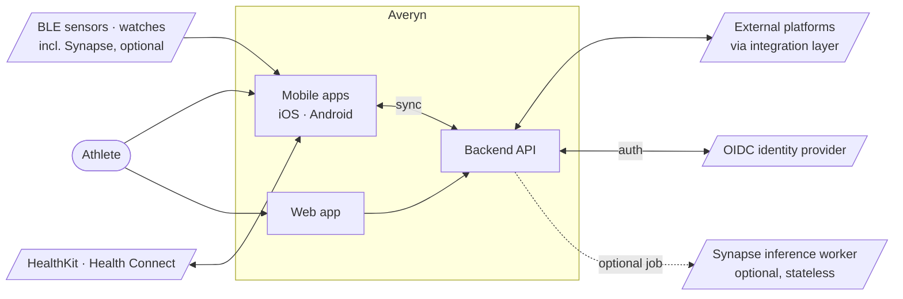
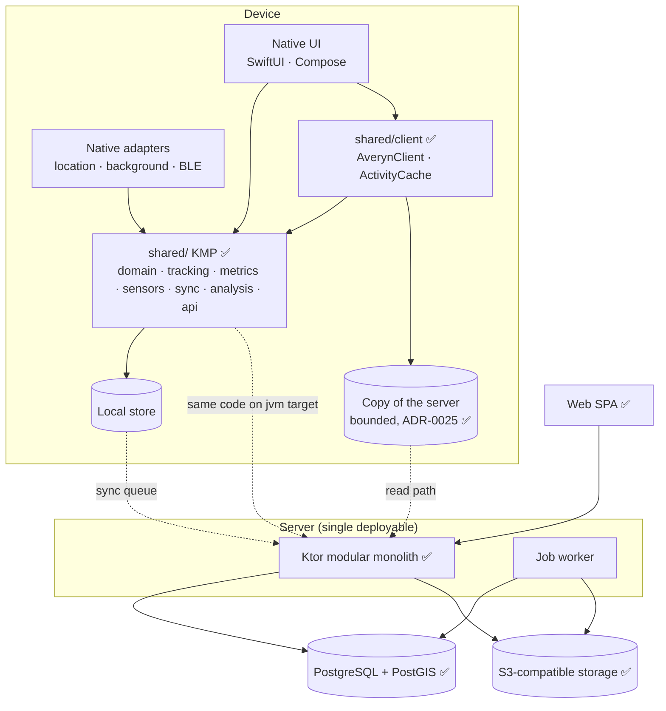

# Architecture overview

Status: v0.2 (2026-10-29) — target architecture. There is no admin or moderation interface: the operator works with runbooks and the database (moderation arrives with MVP-4). `sensors --> mobile` is the only link to Synapse: a band is a BLE sensor read by the phone ([ADR-0026](../adr/0026-averyn-synapse-link.md)).

## System context

## Containers

## Key properties

- **Separation:** acquisition → raw storage → normalization → analysis → sync → presentation → integrations ([report §26](../product/reference-report-v0.1.md)). Raw data is immutable; derived data is versioned.
- **Shared rules:** metrics and validation are one Kotlin implementation used by both device and server ([ADR-0004](../adr/0004-kotlin-multiplatform-shared-native-ui.md)).
- **One deployable server** for both self-hosted and managed cloud ([ADR-0005](../adr/0005-ktor-modular-monolith.md)). This includes any third-party sensor ecosystem: Averyn is the only system of record for users, devices and sessions; a vendor's cloud (e.g. Synapse's) is at most an optional, stateless inference worker Averyn calls, never a second backend ([ADR-0010](../adr/0010-ecosystem-boundary.md), [ADR-0026](../adr/0026-averyn-synapse-link.md)).
- **Identity:** Averyn is an OIDC relying party, not its own identity provider ([ADR-0011](../adr/0011-identity-oidc.md), the default bundled IdP is Zitadel).
- **Sync** is offline-first, idempotent and resumable ([TDD-0002](../design/TDD-0002-activity-sync.md)).
- **One contract, one implementation:** the DTOs of the API live in `shared/api` (used by the server and by the apps), and the read path of the apps is in `shared/client` ([TDD-0011](../design/TDD-0011-mobile-read-path.md)).

## Related

[ADRs](../adr/README.md) · [TDD-0001 Tracking Engine](../design/TDD-0001-tracking-engine.md) · [API](../api/openapi.yaml) · [Synapse integration contract](../integrations/synapse.md)
