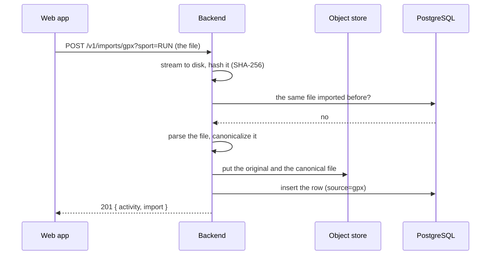

# TDD-0008: GPX import — a file from elsewhere becomes an Averyn activity

- **Status:** implemented
- **Version:** 0.1
- **Author:** @AlessioBrillo
- **Date:** 2026-10-19
- **Related:** [TDD-0002](TDD-0002-activity-sync.md), [TDD-0003](TDD-0003-web-activity-view.md), [TDD-0004](TDD-0004-data-deletion-and-export.md), [ADR-0016](../adr/0016-server-raw-activity-storage.md), [ADR-0017](../adr/0017-data-deletion-and-retention.md), [ADR-0022](../adr/0022-imported-activity-provenance.md), [docs/metrics/gps-quality.md](../metrics/gps-quality.md), [threat model](../privacy/threat-model.md)

## 1. Summary

A user uploads a GPX file from another app or device and gets an activity in Averyn, with the same numbers, on the same web page, as an activity recorded with Averyn itself. The server parses the file, writes the canonical activity file, stores the uploaded file next to it, and computes the summary by replaying the canonical file with the same code the devices use ([ADR-0022](../adr/0022-imported-activity-provenance.md)).

## 2. Goals and non-goals

**Goals:** a GPX file becomes an activity the web app shows (map + metrics); the uploaded file is kept byte-for-byte; the same file is imported once; a file that is not a track is refused with a message that explains why.

**Non-goals (v1):** heart rate, cadence, power or temperature from the file's extensions (they are counted and reported as ignored, the original is kept); FIT and TCX; importing from the mobile apps; editing the sport of an imported activity; a route import (a file with no track points is refused).

## 3. Functional requirements

| ID | Requirement |
|---|---|
| R1 | `POST /v1/imports/gpx?sport=RUN` uploads the file as the request body (`application/gpx+xml`); the sport is explicit and required. |
| R2 | The file is parsed server-side: every `<trkpt>` needs a `<time>` (ISO-8601 with a timezone offset) and a valid coordinate; an elevation is optional. |
| R3 | The canonical activity file holds the same records a recorder writes: the segments become pauses, the samples carry no accuracy, the activity is `COMPLETED`. |
| R4 | The uploaded file is stored next to the canonical one; the export contains both; deleting the activity removes both. |
| R5 | The same file is imported once per owner: the second import answers `200` with the activity that exists. A deleted activity can be imported again. |
| R6 | The quality grade of an imported activity is `UNKNOWN`: a GPX track carries no accuracy and none is invented. |
| R7 | The stored track is a `MultiLineString`: one line per continuous recording interval, so a pause is not drawn as a straight line. |
| R8 | A file that is not a track is refused with `422` and a stable code (`invalid_time`, `invalid_coordinate`, `no_track`, `xml_error`, `non_monotonic_segments`, …); the message never carries a coordinate. |
| R9 | The web app has an import page: file, sport, the result; a duplicate opens the activity that exists. |
| R10 | The import counts against the same per-user quota as everything else, and the same size limit applies. |

## 4. Non-functional requirements

- **Security:** the XML parser has no DTD and no external entities, so an uploaded file cannot make the server read its own files. Limits: 32 MB, 200 000 points, 10 000 segments, 1 000 tracks; at most 2 imports at a time.
- **Determinism:** the same file always produces the same canonical file and the same metrics.
- **Privacy:** the uploaded file is Restricted (it holds a track). It is never logged, never parsed in the browser, and it is covered by export and deletion like every other raw file.
- **Self-hosting:** no new service, no new dependency: the parser is the JDK's, one Flyway migration, one more object prefix.

## 5. Design

### The flow

The order matters: the objects go before the row (a failure leaves an orphan file, never a row without its file), and the row is the only thing that makes the activity visible.

### The canonical file

The canonical file is the store format ([ADR-0015](../adr/0015-local-activity-store.md)), written in one pass:

- `META` line: the activity id, the sport, the start time (the first point's time) and `formatVersion 3`.
- `PREPARING` + `RECORDING` before the first point, `PAUSED` + `RECORDING` between two segments, `STOPPING` + `COMPLETED` at the end, all with `Reason.IMPORTED`.
- One `SAMPLE` per point, with `horizontalAccuracyM: null`.

`formatVersion 3` exists because `horizontalAccuracyM` became nullable: a reader that understands version 3 knows the absence of an accuracy is deliberate.

### The data model

`activities` gains `source` (`device` | `gpx` | …), `source_object_key`, `source_sha256`, `source_size_bytes`, `import_version` and `imported_at`. A unique index on `(owner_id, source_sha256)` makes the same file importable once. The sidecar columns (`rr_object_key`, `rr_sha256`, `rr_size_bytes`) are added in the same migration, so a consent revocation can delete exactly the files it covers ([ADR-0021](../adr/0021-consent-health-data.md)).

The stored `track` changes from `LineString` to `MultiLineString` (`ST_Multi` for the existing rows): one line per continuous recording interval, so a pause is visible on the map for recorded and imported activities alike.

## 6. Test strategy

- **Unit (backend):** the parser reads a valid file, refuses a point without a time, a coordinate out of range, a file with no track, a segment that starts before the previous one ends, and a file with a DOCTYPE (the XXE attempt).
- **Integration (backend):** an import creates the activity with the server's own numbers (elapsed, paused, moving, distance), the track has one line per segment, the original file is in the export, the same file is imported once, deleting the activity removes the original and the file can be imported again, the sport is required, only a GPX file is accepted, the quota counts the original.
- **Web:** the import page asks for a file and a sport and shows the result; the activity detail shows the source and the `UNKNOWN` quality.

## 7. Rollout and migration

Migration `V9__imported_activities.sql` adds the columns, the unique index and the `MultiLineString` track. Existing rows keep `source = 'device'` and are converted with `ST_Multi`. No data is rewritten; the metrics of the existing rows are untouched. The endpoint is additive; the web page is new.

## 8. Risks and mitigations

| Risk | Mitigation |
|---|---|
| An uploaded file makes the server read its own files | The parser has no DTD and no external entities; the file is refused with `xml_error` |
| A huge file costs the server minutes of CPU | 32 MB, 200 000 points, 10 000 segments, 1 000 tracks; at most 2 imports at a time, the rest get `503` |
| An imported activity is graded on a number nobody measured | The accuracy is null, the grade is `UNKNOWN`, and the web app says why |
| The same activity is imported twice | The SHA-256 of the file is unique per owner; the second import returns the first one |
| The extensions of the file are silently dropped | They are counted and reported, and the original file is kept |

## 9. Open questions

- **Extensions (HR, cadence, power):** imported in a later version, from the original files that are already kept ([ADR-0022](../adr/0022-imported-activity-provenance.md)).
- **FIT and TCX:** the next formats, after the analysis of the imported data (they need their own parser and their own extensions).
- **Mobile import:** the API is ready; the mobile apps would upload the same file, and need the server-backed history to show it.
