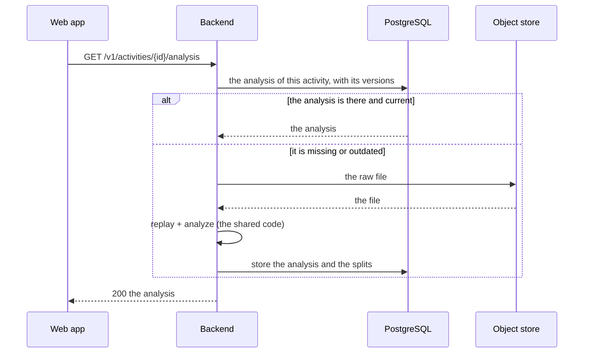

# TDD-0009: Activity analysis — the splits, the elevation and the charts

- **Status:** implemented
- **Version:** 0.1
- **Author:** @AlessioBrillo
- **Date:** 2026-10-20
- **Related:** [TDD-0002](TDD-0002-activity-sync.md), [TDD-0003](TDD-0003-web-activity-view.md), [TDD-0004](TDD-0004-data-deletion-and-export.md), [TDD-0008](TDD-0008-gpx-import.md), [ADR-0016](../adr/0016-server-raw-activity-storage.md), [ADR-0023](../adr/0023-activity-analysis-storage.md), [splits](../metrics/splits.md), [elevation](../metrics/elevation.md), [activity analysis](../metrics/activity-analysis.md), [heart rate](../metrics/heart-rate.md), [threat model](../privacy/threat-model.md)

## 1. Summary

A signed-in user opens an activity on the web and sees what it means, not only how long it lasted: the automatic
splits with their pace, the profile of the altitude, the heart rate over the time. The numbers are computed by the
shared code from the raw file the device uploaded, stored with the version of the algorithm that produced them,
and served by one endpoint. The browser draws what the server computed; it never computes a metric.

## 2. Goals and non-goals

**Goals:** the automatic splits; the elevation; the heart rate over the time; the charts that draw them; the
analysis of an activity that was stored before this increment, or whose algorithms changed; the analysis in the
export and its deletion with the activity.

**Non-goals (v1):** the personal records across the activities (a later increment: they need an eligibility
policy and a sliding window); the digital elevation model (the source of the DEM is still an open decision of the
roadmap, and it belongs to the maps milestone); the analysis on the mobile apps (the endpoint is there, the
screens come later); the editing of a split; the laps the device or the user would cut.

## 3. Functional requirements

| ID | Requirement |
|---|---|
| R1 | `GET /v1/activities/{id}/analysis` returns the analysis of the activity, owner only (`404` for anyone else, like every other activity). |
| R2 | The analysis holds the automatic splits (1 km, 5 km for a ride), the elevation, the heart rate and the totals of the activity. |
| R3 | The splits are cut on the distance, with the boundary interpolated inside the leg that crosses it, and the last split is marked partial. |
| R4 | The time of a split is the moving time; the elapsed time is shown next to it. |
| R5 | The elevation is estimated from the altitude the samples carry: median of five, 3 m threshold, reset at the pauses. An activity without altitude has no elevation, not a flat one. |
| R6 | The series is bounded (2 000 points of the track, 1 000 of the heart rate) and carries the segment of every point: the line of the chart breaks at a pause and at a dropout of the sensor. |
| R7 | The analysis is computed when the activity is stored, and it is recomputed when it is missing or when the algorithms changed. |
| R8 | The web app shows the splits in a table, the elevation and the heart rate in two charts, and the numbers of the analysis next to the ones of the activity. |
| R9 | The analysis is part of the export of the account (`analysis/<id>.json`) and it is deleted with the activity. |
| R10 | Every number declares the algorithm that produced it (`splits-v1`, `elevation-v1`, `series-v1`, `hr-v2`). |

## 4. Non-functional requirements

- **Determinism:** the same raw file always produces the same analysis: the shared code computes it, on the
  device and on the server, exactly like the other metrics (TDD-0002 S3).
- **Privacy:** the analysis holds the heart rate and the derived location data: it is Restricted, it is owner
  only, it is never logged, and it is covered by the export and by the deletion.
- **Self-hosting:** no new service, no new dependency on the server: one more Flyway migration and one more
  table.
- **Size:** the analysis of an activity is a few tens of kilobytes; the series is bounded.

## 5. Design

### 5.1 The flow



### 5.2 The module

`shared/analysis` is a new pure module: it depends on `shared:domain`, `shared:metrics` and `shared:sensors`, and
on nothing else. It holds the analyzer (the splits, the elevation, the series) and the decimation. It does not
know about the database, about the object store or about the web: the server replays the file and feeds it.

The backend holds the orchestration: `ActivityAnalyzer` (the replay that feeds the analyzer), `AnalysisService`
(the recomputation on demand) and `ActivityAnalysisStore` (the rows).

### 5.3 The data model

`V10__activity_analysis.sql`:

- `activities` gains `stationary_ms` (the time the activity was recording and the user was not moving, computed
  by `time-v1` and thrown away until now) and `hr_algorithm_version` (the heart rate of the summary now says
  which algorithm computed it).
- `activity_analyses` holds one row per activity: the versions, the split length, the elevation, the quality of
  the heart rate and the series (JSONB).
- `activity_splits` holds one row per split. Both tables are deleted with the activity (`ON DELETE CASCADE`).

### 5.4 When the analysis is computed

- **When the activity is stored:** the ingest already replays the file for the summary and the track, so the
  analysis costs no second pass. If the analysis cannot be stored, the activity is still stored: the analysis is
  derived data, it must not make an upload fail, and it is computed the first time the activity is read.
- **When it is read:** an activity stored before this increment, or one whose algorithms changed, is analysed the
  first time it is read. Two analyses at a time are computed (a semaphore); a third request gets `503` and a
  `Retry-After`, like the uploads.
- **On demand:** a command recomputes the analysis of every activity that has none (see §7).

### 5.5 The charts

The web app draws the series with [uPlot](https://github.com/leeoniya/uPlot), loaded when the chart is drawn and
not when the page is: an activity without a chart must not pay for the library. The line breaks where the segment
of a point changes (a pause, a dropout), because a line across a gap would invent what was not measured. The
splits are also a table: the table is the accessible representation of the numbers, the chart is the picture.

## 6. Test strategy

- **Unit (`shared/analysis`):** a straight run is cut in one-kilometer splits that add up to the track; a ride is
  cut in five; the last split is partial; a pause is not crossed by the distance; the stationary legs are not
  moving time; a steady climb is counted; an altitude that only jitters is not a mountain; an activity without
  altitude has no elevation; the heart rate is measured over the recording time, the pauses excluded; the series
  is bounded and keeps the first and the last point.
- **Integration (backend):** the analysis is stored when the activity is; its splits add up to the distance of
  the summary and its totals are the ones of the summary; it is only for its owner; it is computed again when it
  is missing or outdated; it is deleted with the activity and with the account; the export holds it.
- **Web (Vitest):** the elevation profile breaks at a pause and at a missing altitude; the heart rate breaks at a
  dropout; the page shows the splits, the elevation and the heart rate.
- **Manual, real stack:** sign in with a browser, open an uploaded activity, compare the splits with the ones of
  the device that recorded it, and check that the export holds the analysis.

## 7. Rollout and migration

`V10` is forward-only: it adds the columns, the tables and backfills the stationary time of the existing rows
(`elapsed - moving - paused`, exact for the rows that exist). The analysis of the activities stored before it is
computed the first time it is read; a command recomputes them all at once:

```sh
./gradlew :backend:backfillAnalysis
```

The endpoint is additive; the web page is new.

## 8. Risks and mitigations

| Risk | Mitigation |
|---|---|
| The analysis of an old activity is computed while the user waits | The computation is bounded (a semaphore) and the answer is stored: the next read is immediate |
| The altitude of a GNSS receiver is wrong and the profile shows a mountain | The median of five and the 3 m threshold; the app says the elevation is estimated from the recorded altitude |
| The chart invents a heart rate across a dropout | The series carries the segment of every point and the line breaks there |
| A change of algorithm leaves the stored analyses outdated | The versions are stored with the numbers; the outdated ones are recomputed on the next read |
| The analysis of an activity is a lot of rows | The series is one JSONB document and the splits are one row each (ADR-0023) |
| The upload of an activity fails because of the analysis | The analysis is stored after the activity, and a failure of the analysis never fails the upload |

## 9. Open questions

- **The personal records:** the best efforts need a policy of eligibility (an imported file? a poor quality? a
  pause?) and a sliding window over the track. They are the next analysis increment, not this one.
- **The digital elevation model:** the source is still open (roadmap). When it is chosen, it becomes an
  `elevation-v2` with the same interface: the shape of the analysis does not change.
- **The analysis on the mobile apps:** the endpoint is there. The screens are a later increment, and the charts of
  the web are the reference.
