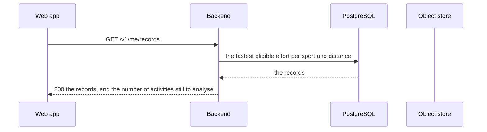

# TDD-0010: Best efforts and personal records — the fastest kilometre of an account

- **Status:** implemented
- **Version:** 0.1
- **Author:** @AlessioBrillo
- **Date:** 2026-10-21
- **Related:** [TDD-0009](TDD-0009-activity-analysis.md), [TDD-0002](TDD-0002-activity-sync.md), [TDD-0004](TDD-0004-data-deletion-and-export.md), [ADR-0016](../adr/0016-server-raw-activity-storage.md), [ADR-0017](../adr/0017-data-deletion-and-retention.md), [ADR-0023](../adr/0023-activity-analysis-storage.md), [ADR-0024](../adr/0024-personal-records.md), [best efforts](../metrics/best-efforts.md), [splits](../metrics/splits.md), [distance](../metrics/distance.md), [threat model](../privacy/threat-model.md)

## 1. Summary

A signed-in user opens the **Records** page and sees the fastest kilometre, the fastest five and the fastest
ten of their account, with the activity that holds them. The numbers are computed by the shared code from the
raw file the device uploaded, stored with the version of the algorithm that produced them, and served by one
endpoint. The browser draws what the server computed; it never computes a record.

A best effort is the fastest window of the track that covers exactly a distance of the sport. It is not a
split: a split is a fixed piece of the track, a best effort is the fastest kilometre of the whole activity,
wherever it happens to be.

## 2. Goals and non-goals

**Goals:** the best efforts of an activity; the personal record of an account for every distance of every
sport; a rule of eligibility that is written in one place; a record that moves on by itself when the activity
that held it is deleted; the records in the export; the honesty of a list that is not complete yet.

**Non-goals (v1):** the history of the records and how they improved; the yearly or seasonal records; a badge
on the activity that holds a record; a public profile, a leaderboard or a segment (MVP-4); the competitive
records, whose eligibility is stricter; the analysis on the mobile apps; the imperial distances; the reading of
the file on the device (the server is the system of record).

## 3. Functional requirements

| ID | Requirement |
|---|---|
| R1 | The analysis of an activity holds its **best efforts**: the fastest window of each target distance of the sport (`best-efforts-v1`). |
| R2 | The targets of the sport are the standard ones: 1/5/10 km, half and marathon for a run; 5/10/20/40/50/100 km for a ride; 1/5/10 km for a walk and for a hike. |
| R3 | An effort never crosses a pause and never crosses a signal gap; its time is the moving time; the wall time is stored next to it. |
| R4 | A window that does not move, or that is faster than the sport allows, is not an effort. |
| R5 | `GET /v1/me/records` returns the records of the caller: every target distance of every sport they have one of, the record of it, and the version of the algorithm. |
| R6 | An activity holds a record when it finished, when it comes from Averyn or from a GPX file, and when its quality is not `POOR`. The rule is in one place. |
| R7 | The record is the fastest eligible effort of the account; a tie goes to the oldest one. |
| R8 | Deleting the activity that holds a record promotes the next one, with nothing to keep in step. |
| R9 | The response says how many activities of the account have no analysis yet: a list that can be incomplete says so. |
| R10 | The analysis of the activity that holds a record is recomputed when it is missing or when the algorithms changed, like every other analysis. |
| R11 | The records are part of the export (`records.json`), next to the analysis of every activity. |
| R12 | The web app has a Records page, and the detail page of an activity shows its best efforts. |

## 4. Non-functional requirements

- **Determinism:** the same raw file always produces the same best efforts: the shared code computes them, on
  the device and on the server, exactly like the other metrics (TDD-0002 S3).
- **Privacy:** the records are derived from the track: they are Restricted, they are owner-only, they are never
  logged, and they are covered by the export and by the deletion. A record holds no coordinate.
- **Self-hosting:** no new service, no new dependency on the server: one more Flyway migration, one more
  table, one more index.
- **Cost:** the search is linear in the number of samples, for every target of the sport: an imported file of
  200 000 points is a few million operations, in the replay the ingest already does.
- **Honesty:** the record of an account is never shown as complete when it is not.

## 5. Design

### 5.1 The flow



The records are not stored: they are the fastest best efforts of the account, read with one query
([ADR-0024](../adr/0024-personal-records.md)). Deleting the activity that holds one promotes the next one by
itself.

### 5.2 The module

`shared/analysis` holds the algorithm: `bestEfforts(sport, segments)` returns the fastest window of every
target of the sport, and `fastestWindowOf` is the same search with the distance left to the caller (it is what
the tests of the algorithm use). The module depends on `shared:domain` and `shared:metrics`, and on nothing
else.

The track of the activity (the points, the legs, the distance and the moving time of every leg) is built once
per analysis and shared by the splits, the elevation, the series and the best efforts: the same activity never
has two distances.

### 5.3 The search

For every target of the sport, the window is searched twice:

- the window **starts on a sample** and ends inside the leg that crosses the target;
- the window **ends on a sample** and starts inside the leg that crosses the target.

The faster of the two is the effort. The search is a two-pointers walk over the samples of the stretch: it is
linear in the number of samples, for every target.

The details (the gaps, the moving time, the caps of plausibility) are in the metric spec:
[best-efforts.md](../metrics/best-efforts.md).

### 5.4 The data model

`V11__activity_best_efforts.sql`:

- `activity_best_efforts` holds one row per target distance of the activity: the distance, the moving time, the
  wall time, where the effort is on the track and when it happened, the speed and the pace.
- `activity_analyses` gains `best_efforts_version`: the version of the algorithm that produced the stored
  efforts. The rows that have no version are the ones stored before the best efforts existed: they are
  recomputed the first time the activity is read.
- `activities` gains an index on `(owner_id, sport)`: the lookup of the records is by owner and sport.

The efforts are deleted with the activity, and they do not count against the storage quota (ADR-0023).

### 5.5 When the best efforts are computed

- **When the activity is stored:** the ingest already replays the file for the summary and the track, so the
  best efforts cost no second pass. If they cannot be stored, the activity is still stored: the analysis is
  derived data, it must not make an upload fail, and it is computed the first time the activity is read.
- **When it is read:** an activity stored before this increment, or one whose algorithms changed, is analysed
  the first time it is read. Two analyses at a time are computed (a semaphore); a third request gets `503` and
  a `Retry-After`, like the uploads.
- **On demand:** the command `backfillAnalysis` recomputes the analysis of every activity that has none.

The **records** are never computed by a request: the endpoint reads what is stored. An account whose
activities are not all analysed yet has a `pendingActivities` count, and the page says that the list can be
incomplete.

## 6. Test strategy

- **Unit (`shared/analysis`):** the targets of the sport; a straight run has an effort for every target it
  reaches; the fastest window is not the first split; a window that starts in the middle of a leg is found; a
  pause breaks the effort; a signal gap breaks the effort and a short one does not; the stationary legs are not
  moving time; a window that is faster than the sport allows is not an effort; an activity shorter than the
  target has none.
- **Integration (backend):** the efforts are stored with the analysis and are part of the response; the record
  is the fastest of the account; the records are only for their owner; an activity of poor quality does not
  hold a record; deleting the activity that holds the record promotes the next one; an activity stored before
  the best efforts existed is analysed when it is read; the export holds the records.
- **Web (Vitest):** the Records page shows the record of every distance, the distances without a record, the
  provenance and the quality of the record, the warning of an incomplete list; the analysis shows the best
  efforts of the activity.
- **Manual, real stack:** record an activity, open it on the web, compare the effort with the splits of the
  same activity, delete it and see the record move to the next one.

## 7. Rollout and migration

`V11` is forward-only: it adds the table, the column and the index, and renames `series_schema_version` into
`analysis_schema_version` (it holds the version of the shape of the document, not of one of its series). The
analyses that exist have no best efforts: they are recomputed the first time their activity is read, and the
command `backfillAnalysis` recomputes all of them at once:

```sh
./gradlew :backend:backfillAnalysis
```

The endpoint is additive; the web page is new. The shape of the analysis document is version 2: the new field
is additive, and a client that does not know it ignores it.

## 8. Risks and mitigations

| Risk | Mitigation |
|---|---|
| A record is born from a bad track | The quality filter excludes the jumps; a window that is faster than the sport allows is skipped; an activity of poor quality does not hold a record |
| A long silence gives the athlete distance nobody ran | An effort never crosses a silence longer than the threshold of the metric |
| The record list is quietly incomplete | The response says how many activities are not analysed yet, and the page says it |
| The record of an account is a query over many activities | One index and a small query; the record of an account is read once per page |
| A stored record goes stale when the activity is deleted | There is no stored record: the query promotes the next one by itself |
| The user expects the record of the device, not of the account | The device does not compute records: the account is the system of record (ADR-0016) |

## 9. Open questions

- **The history of the records:** how a record improved over the months is a later increment: it needs a
  history, and a history is a thing to store.
- **The competitive records:** the segments and the leaderboards of MVP-4 need a stricter eligibility, a
  verification and the privacy zones. They are a different feature, and the rule of the personal records does
  not apply to them.
- **The units of the account:** the imperial distances come with the profile of the user. The metric is
  versioned: the targets of the sport are part of the algorithm.
